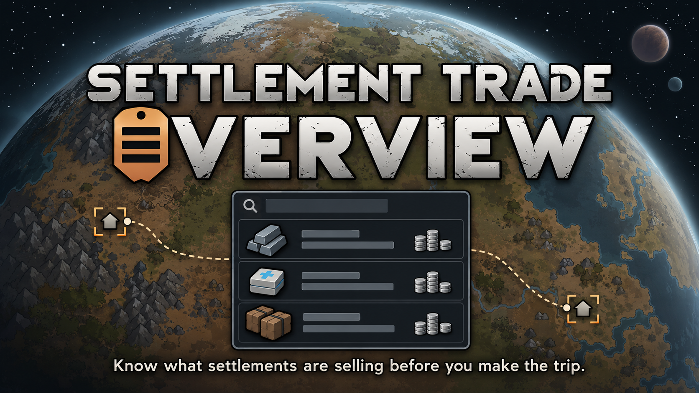

# [Settlement Trade Overview](https://steamcommunity.com/sharedfiles/filedetails/?id=3781528628)



**Know what settlements are selling before you make the trip.**

Settlement Trade Overview lets you inspect the current trade stock offered by world settlements before deciding where to send your caravan. Browse settlements together in one overview or inspect a selected settlement on the world map.

## Features

- Search offers by item, pawn or settlement and filter them by category.
- Sort offers by item, details, count, settlement, price, distance or restock information.
- See estimated purchase prices using an available negotiator, or market value when no negotiator is available.
- Check distance separately from ground-route availability.
- Inspect pawn trade details and restock information.
- Choose which settlements appear and refresh their displayed trade data.
- Optionally highlight genepacks relevant to unfinished Xenogerm Planner plans.

## Requirements and installation

- RimWorld 1.6 or 1.7.
- No DLC or Harmony required.
- Biotech is needed for genepack features. Royalty enables the optional title-based trade filter.

Subscribe on [Steam Workshop](https://steamcommunity.com/sharedfiles/filedetails/?id=3781528628), let Steam download the mod, then enable **Settlement Trade Overview** in RimWorld's Mods menu and restart as requested. Check the supported game versions listed on the Workshop page before subscribing.

For a manual installation, place the complete mod package in `RimWorld/Mods/SettlementTradeOverview/`, with `About/` directly inside that folder. When building from source, use [deployment](#deploying-a-development-build) to prepare a complete installation. The repository's `mod/` directory and GitHub source archives contain shared content and historical DLLs, but no current DLL.

To update a manual installation, close RimWorld and replace the installed mod folder with the complete package. Replacing the folder prevents duplicate DLLs from an older installation. Steam handles updates for Workshop installations. To remove the mod, disable it and restart, then delete the manual copy or unsubscribe. See [Compatibility](#compatibility) before adding or removing the mod in an existing save.

## Usage

1. Load a colony and open **trade overview** from the main tabs. For a single settlement, select it on the world map and choose **View trade stock**.
2. Use search, categories and column headers to narrow down the offers.
3. Check the price, distance and restock information, then visit the settlement through the normal caravan system.
4. Use **Refresh** to read the current settlement stock again.

The active colony map is the origin for distance and negotiator selection. If no offers appear, check the [settlement filters](#settings). With the default settings, a powered communications console is required.

## Trade data and refresh behavior

Opening the overview reads actual settlement stock. RimWorld may generate stock that has not been generated yet as part of that read. Initial loading or refreshing many settlements can therefore cause a temporary pause.

**Refresh** reads the current stock again. It does not force a restock or change RimWorld's restock schedule. Reopening the overview may reuse previously loaded data; use Refresh when you need up-to-date information. Restock times remain relative to the last refresh rather than counting down continuously.

On RimWorld 1.7, when **Require Royalty trade permission** is enabled, use **Refresh** after colonists gain or lose qualifying titles, or arrive at or leave the active map. Closing and reopening the overview alone may retain the previous settlement list. Refresh reevaluates title-based trade permission using the colonists currently on that map.

Distances are approximate world-tile distances from the active map. A settlement can have a distance even when no ground route exists. On 1.7, between different world layers, distance is unavailable and no ground route is offered; the distance and reachable-route filters exclude these settlements when enabled.

## Xenogerm Planner integration

With Biotech and [Xenogerm Planner](https://steamcommunity.com/sharedfiles/filedetails/?id=3781523927), genepacks can show a relevance indicator in the **Details** column. Hover it to see matching unfinished plans.

For manual installation, download `XenogermPlanner-v1.2.0.zip` from the [Xenogerm Planner v1.2.0 release](https://github.com/EscarvalOokt/XenogermPlanner/releases/tag/v1.2.0). The automatic source archives do not include the current compiled mod.

Offers remain suggestions and do not count toward plan readiness until acquired. Reopen the overview after changing a plan to update relevance. The integration is optional; unavailable or incompatible Planner versions leave ordinary stock browsing available.

## Settings

Open RimWorld's mod settings and select **Settlement Trade Overview**.

| Setting | Default and effect |
| --- | --- |
| Show global trade overview tab | On. Hiding it keeps settlement-specific commands available. |
| Require a powered communications console | On. Accepts a powered console on the current map or another player home map. |
| Require Industrial technology or higher | On. Filters by the settlement faction's technology level. |
| Limit maximum distance | On, with a limit of 40 world tiles. The limit can be set up to 3000. |
| Require a reachable route | On. Requires a traversable ground route from the active map. |
| Require Royalty trade permission | Off. When enabled with Royalty, requires an available colonist to meet the settlement's royal title requirement. |

Settings are saved in RimWorld's mod configuration. The Royalty setting has no effect when that DLC is inactive.

## Compatibility

To add the mod to an existing save, enable it, restart RimWorld and load the save. When moving a save from RimWorld 1.6 to 1.7, install the complete mod package so the game can select the matching DLL.

Removing the mod from a RimWorld 1.7 save can produce two load errors referring to `GameComponent_SettlementTradeOverview` and `Verse.GameComponent`. The colony still loads. Save it under a new name with the mod disabled, then load that new save; the missing-component errors no longer occur. Keep the original save until you have checked the new copy.

Ordinary goods and genes are handled through RimWorld's trading systems. Mods that replace settlement definitions, stock handling or trade grouping may need separate compatibility work. Independently defined settlement-like world objects may not receive **View trade stock** automatically.

## Languages

- English
- Russian
- Ukrainian
- Spanish — provided by Annabelesca
- Latin American Spanish — provided by Annabelesca
- Simplified Chinese — provided by OPPO9008

## Development

The source project targets `net10.0` and builds the RimWorld 1.7 DLL. The package also includes a prebuilt RimWorld 1.6 DLL, which must remain unchanged.

### Prerequisites

- A local RimWorld 1.7 installation with `Assembly-CSharp.dll` and `UnityStubs.dll`.
- A .NET 10 SDK, or a compatible SDK capable of targeting `net10.0`, and a .NET 10 runtime for running tests.
- The [Escarval.RimWorld.UI v1.0.0](https://github.com/EscarvalOokt/Escarval.RimWorld.UI/releases/tag/v1.0.0) sources, obtained as described below.

The production project imports `Escarval.RimWorld.UI.Source.projitems`, which defines the shared source files and excludes the library's `bin/` and `obj/` directories. The shared UI source is compiled into `SettlementTradeOverview.dll`; no separate UI library build or runtime mod is needed. STO supplies the game references and compiler settings for the imported source.

### Shared UI source

Download **Source code (zip)** or **Source code (tar.gz)** from the [v1.0.0 release](https://github.com/EscarvalOokt/Escarval.RimWorld.UI/releases/tag/v1.0.0) and extract the complete archive to a directory that will remain available during STO builds. The extracted source root is `Escarval.RimWorld.UI-1.0.0`; it contains the required file at `src/Escarval.RimWorld.UI/Escarval.RimWorld.UI.Source.projitems`.

For example, if the source root is `C:\Dependencies\Escarval.RimWorld.UI-1.0.0`, set this property in `src/SettlementTradeOverview.Local.props` after copying the [configuration example](docs/SettlementTradeOverview.Local.props.example):

```xml
<EscarvalRimWorldUiProjectDir>C:\Dependencies\Escarval.RimWorld.UI-1.0.0\src\Escarval.RimWorld.UI</EscarvalRimWorldUiProjectDir>
```

As an alternative to an archive, run this command from the STO repository root to clone the same release tag into a new sibling directory:

```text
git clone --branch v1.0.0 --depth 1 https://github.com/EscarvalOokt/Escarval.RimWorld.UI.git ../Escarval.RimWorld.UI
```

Use the release tag for this setup. STO compiles the files currently present at `EscarvalRimWorldUiProjectDir`; the build does not download the library or enforce its version. For the library's integration contract and API, see the versioned [Consumer Integration](https://github.com/EscarvalOokt/Escarval.RimWorld.UI/blob/v1.0.0/docs/integration.md) and [Public API Reference](https://github.com/EscarvalOokt/Escarval.RimWorld.UI/blob/v1.0.0/docs/api.md).

### Local configuration

Copy [the configuration example](docs/SettlementTradeOverview.Local.props.example) to `src/SettlementTradeOverview.Local.props`, which is ignored by Git.

- Set `RimWorldManagedDir` to the RimWorld 1.7 directory containing `Assembly-CSharp.dll` and `UnityStubs.dll`. On Windows, this is the game installation root.
- Set `EscarvalRimWorldUiProjectDir` to the absolute path of the directory containing `Escarval.RimWorld.UI.Source.projitems`, as in the archive example above. Specify the inner `src/Escarval.RimWorld.UI/` directory, not the source root or the `.projitems` file itself. For a checkout named `Escarval.RimWorld.UI`, the build can also discover `../Escarval.RimWorld.UI/src/Escarval.RimWorld.UI/` or `../../Escarval.RimWorld.UI/src/Escarval.RimWorld.UI/`, relative to this repository root. The versioned archive folder is not discovered automatically.
- Leave `DeployToGame` false for ordinary development. Configure `RimWorldModAssembliesDir` only when opting into deployment; it must name the `Current/Assemblies/` directory of the intended development installation.

### Build

From the repository root:

```text
dotnet build src/SettlementTradeOverview.sln -c Release
```

The current DLL is written under `src/SettlementTradeOverview/bin/Release/`. Ordinary builds and tests leave `mod/` and the game installation unchanged. The repository contains no generated current assembly directory.

### Deploying a development build

Set `RimWorldModAssembliesDir` to the absolute destination `<mod directory>/Current/Assemblies/`, using this casing. Close RimWorld before updating its installed mod, then run:

```text
dotnet build src/SettlementTradeOverview.sln -c Release -p:DeployToGame=true
```

Deployment creates or updates the complete mod in the directory above `Current`. It copies shared content and the preserved historical DLLs from `mod/`, writes the built `SettlementTradeOverview.dll` to `Current/Assemblies/`, and installs `LoadFolders.xml` with the matching version selection:

```text
SettlementTradeOverview/
  About/
  LoadFolders.xml
  Defs/, Patches/, Languages/, Textures/   Shared content
  1.6/Assemblies/SettlementTradeOverview.dll   Preserved RimWorld 1.6 assembly
  Current/Assemblies/SettlementTradeOverview.dll   Current build for RimWorld 1.7
```

The deployment rules are in [ModDeployment.targets](build/ModDeployment.targets). Before changing the destination, they validate its location, an existing package ID, the current load-folder mapping and the historical DLL checksums. A destination inside the source repository, its ancestors, the game root, another mod, or a path through symbolic links/junctions is rejected.

Deployment replaces the managed `About`, `Defs`, `Patches`, `Languages`, `Textures`, `Sounds`, `Resources`, `Common`, historical-version and `Current` directories. It also removes obsolete root `Assemblies/` and the numbered directory of the current game version (`1.7/` today). Files outside these directories are preserved; keep personal files there. A local `About/PublishedFileId.txt` is preserved when the source package does not supply it.

Use the deployed directory as the installable package. For a release archive, deploy to a clean external directory by overriding `-p:RimWorldModAssembliesDir=<absolute staging directory>/Current/Assemblies/`, then archive the resulting mod directory. A clean destination avoids including unrelated files preserved from a development installation. Game/reference DLLs, test assemblies and a standalone shared UI DLL are not copied.

`LoadFolders.xml` selects the shared root plus `1.6` for RimWorld 1.6, or the shared root plus `Current` for 1.7. When a future game version needs a different DLL, preserve the last compatible DLL in its numbered directory under `mod/`, add its `HistoricalModVersion` entry and SHA-256 in the production project, update `CurrentRimWorldVersion`, and update `LoadFolders.xml` and `About.xml` so the new version uses `Current`. Historical DLLs are never rebuilt from current source.

### Tests

```text
dotnet test tests/SettlementTradeOverview.Tests/SettlementTradeOverview.Tests.csproj -c Release
```

The test command also builds the production project, so it uses the same local configuration. Tests run on the standard .NET 10 runtime. Leave `DeployToGame=false` to test without updating the installed mod.

The NUnit suite covers query, snapshot, eligibility, cache, settings, presentation and optional-integration behavior. Generic controls are tested separately in `Escarval.RimWorld.UI`. In-game acceptance is also required to verify the mod under RimWorld 1.7's Waylith runtime. See [Testing policy](docs/testing.md) for test coverage and manual verification procedures.

## Repository structure

```text
assets/   Source visual assets
build/    MSBuild deployment rules
docs/     Architecture, test policy and public configuration example
mod/      Shared game content and preserved historical DLLs
src/      Production source and solution
tests/    NUnit test project
```

## Technical documentation

- [Architecture](docs/architecture.md)
- [Testing policy](docs/testing.md)